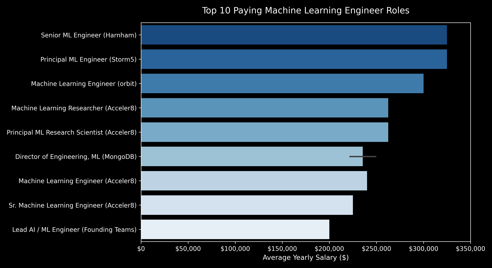
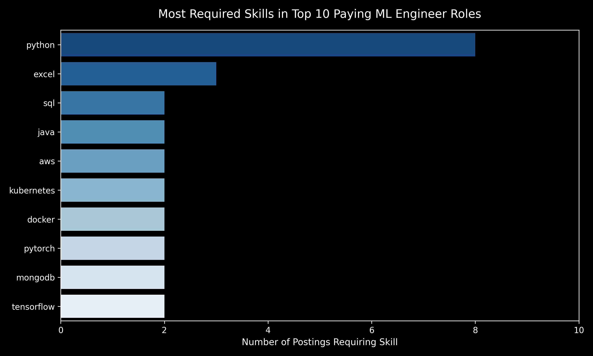
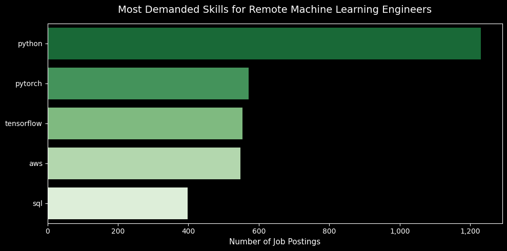
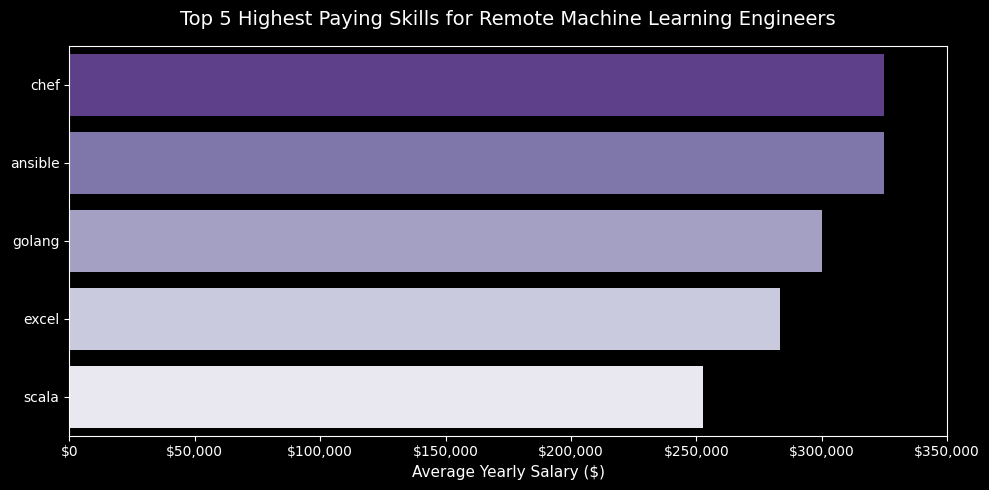
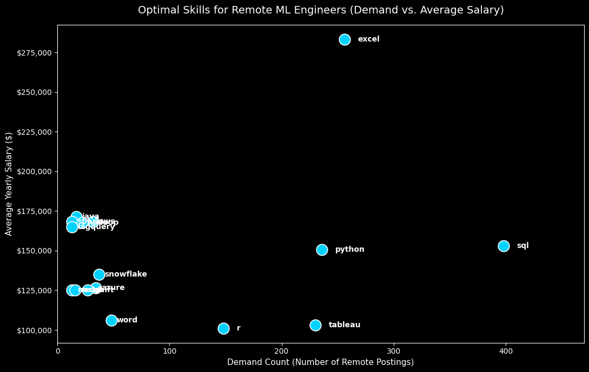

# SQL Job Market Analysis

A data driven analysis of the job market for Machine Learning Engineers, examining required skills, salary trends, in demand technologies, and top paying roles using PostgreSQL.

---

## Background & Motivation

Machine Learning Engineering requires a blend of scalable system design, MLOps, deep learning frameworks, software engineering principles, and core database management. 

### The questions I wanted to answer through my SQL queries were:

1. What are the top paying Machine Learning Engineer jobs?
2. What skills are required for these top paying jobs?
3. What skills are most in demand for Machine Learning Engineers?
4. Which skills are associated with higher salaries?
5. What are the most optimal skills to learn?

Data is sourced from the dataset located in the [csv_files](csv_files/) folder. It contains detailed information on job titles, salaries, locations, and required technical skills.

---

## Data & Tools Used

- **Database Engine:** PostgreSQL
- **Development Environment:** Antigravity IDE / Visual Studio Code, Git/GitHub
- **Dataset:** Tech job postings database with company details, job titles, locations, required skills, and salary figures.

---

## Analysis & Findings

### 1. Top Paying Roles for Machine Learning Engineers

This analysis identifies the highest paying Machine Learning Engineer positions across remote and global postings. 

📄 *Query script:* [`project_sql/1_top_paying_jobs.sql`](project_sql/1_top_paying_jobs.sql)

Looking at broader ML leadership and engineering roles across the full dataset, companies like Glocomms offer up to **$425,000** for Applied Data Science/ML Leaders, while Stripe and Pinterest offer **$350,000** for ML leadership roles. The database covers **11,824 companies** recruiting for ML talent.

---

### 2. Required Skills for Top-Paying ML Engineer Roles

This analysis maps specific technical skills directly to the top paying ML job openings to pinpoint what high-compensation roles require.

📄 *Query script:* [`project_sql/2_top_paying_job_skills.sql`](project_sql/2_top_paying_job_skills.sql)

---

### 3. Most In-Demand Skills for Remote Machine Learning Engineers

This analysis evaluates job posting frequencies to identify the most commonly requested technical skills for remote ML Engineers.

📄 *Query script:* [`project_sql/3_top_demanded_skills.sql`](project_sql/3_top_demanded_skills.sql)

---

### 4. Top Skills Based on Salary Premium

This analysis calculates which technical skills yield the highest average salary figures for remote positions.

📄 *Query script:* [`project_sql/4_top_skills_based_on_salary.sql`](project_sql/4_top_skills_based_on_salary.sql)

---

### 5. Optimal Skills to Learn (High Demand + High Salary Synergy)

This analysis filters for optimal target skills by combining high job posting demand with top tier salary averages.

📄 *Query script:* [`project_sql/5_optimal_skills.sql`](project_sql/5_optimal_skills.sql)

---

## Insights

1. **Python is Essential:** Python leads all technical requirements by a large margin with 1,230 remote job postings, maintaining an average salary over $150,000 for remote positions.
2. **Deep Learning Frameworks:** PyTorch (571 postings) and TensorFlow (553 postings) form the core modeling stack required by hiring teams.
3. **Infrastructure and MLOps Pay Premiums:** Automation and cloud orchestration tools like AWS, Kubernetes, Docker, Chef, and Ansible appear consistently in $300,000+ positions, confirming that production deployment capabilities drive upper tier salaries.
4. **Data Engineering Foundations:** SQL remains a mandatory core skill (398 remote postings, $152,983 average salary) alongside big data platforms like Spark and Airflow.

---
